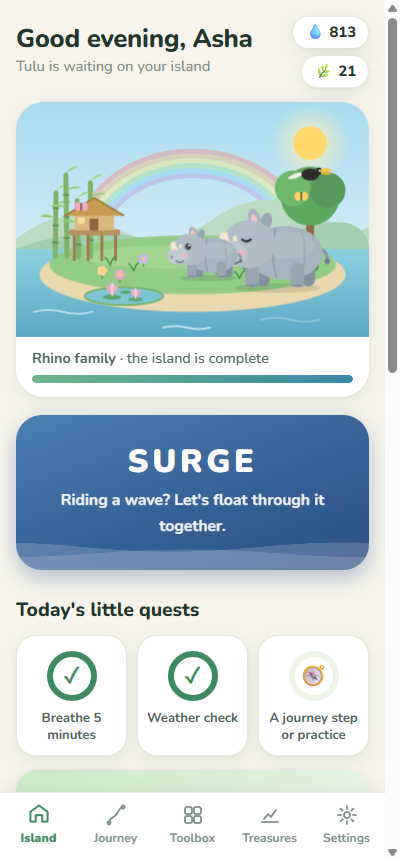
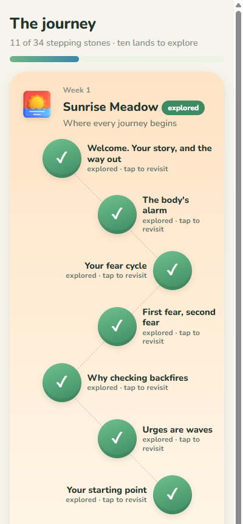
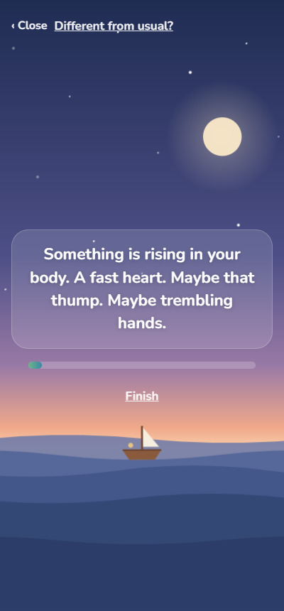
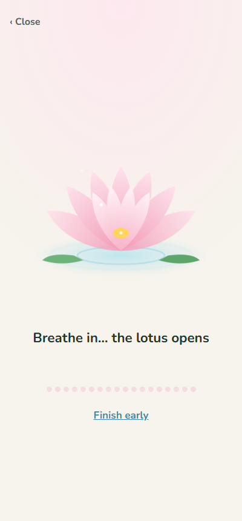
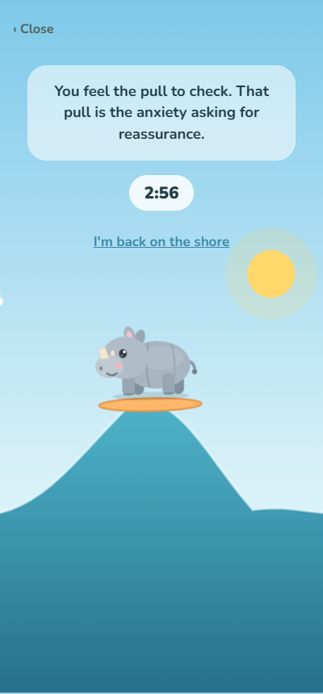
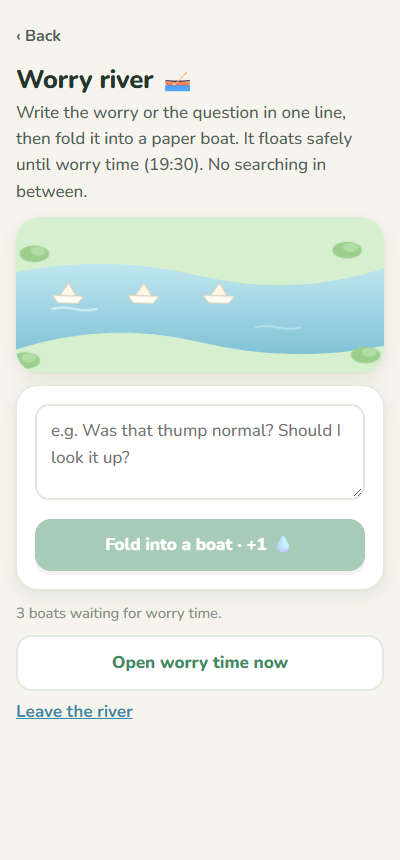
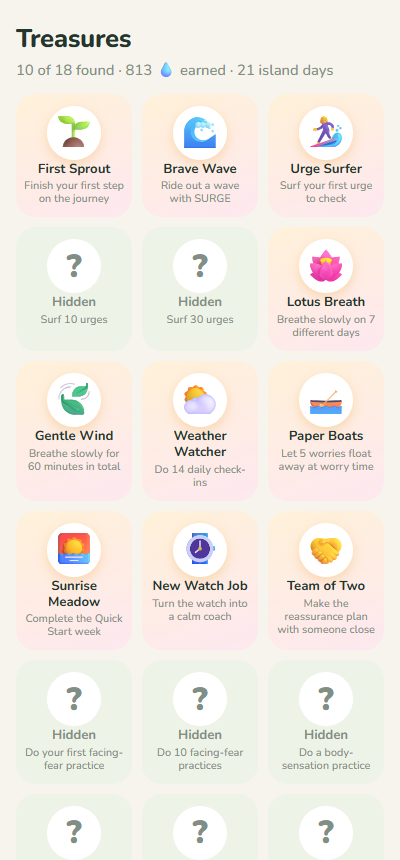
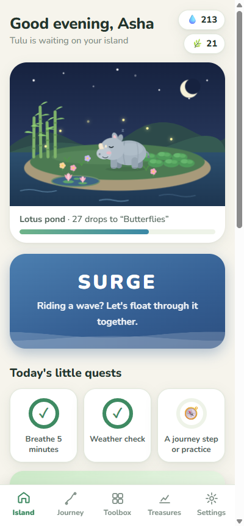

# Calm Path: a playful companion for recovering from health anxiety

[](https://tarunabhdutta.github.io/calm-path/)
[](https://github.com/tarunabhdutta/calm-path/releases/latest)
[](LICENSE)

**▶ Try it in your browser: https://tarunabhdutta.github.io/calm-path/**

### 👉 [Simple step-by-step install guide](INSTALL.md) (Android, iPhone and Windows)

Calm Path helps people whose fear of their own body has taken over: a racing heart, a "thump" in
the chest, the urge to check the pulse, ask "am I OK?" or search symptoms again and again. It turns
a structured, self-guided CBT programme for **health anxiety** into something that feels like a
gentle game, not a therapy session.

You look after **Tulu**, a baby one-horned rhino from the river islands of Assam. Every bit of
practice waters your island and helps it grow.

- **Free, offline, private.** No account, no sign-up, no ads, no tracking. Your entries stay on
  your own device.
- **Android app, Windows app and web app.** The web app also installs on iPhone and Mac.

| Your island | The journey | SURGE | Lotus breathing |
|---|---|---|---|
|  |  |  |  |
| **Surf an urge** | **Worry river** | **Treasures** | **Night island** |
|  |  |  |  |

---

## What's inside

**A 10-week journey (35 short sessions)** across ten lands: Sunrise Meadow, Bamboo Grove, Tea
Hills, River Crossing, Lotus Pond, Firefly Forest, Hornbill Heights, Cloud Bridge, Rhino Plains and
the Island of Calm. It covers:
- understanding the body's alarm and your own fear cycle;
- dropping checking and reassurance-seeking, step by step;
- facing feared situations and body sensations (exposure);
- unhooking from anxious thoughts, getting life back, and a plan to stay well.

The full text is in [docs/PROGRAMME.md](docs/PROGRAMME.md).

**Tools that are always one tap away:**
- **SURGE:** a 2½-minute guided way to float through a wave of anxiety on a calm dusk sea.
- **Surf an urge:** instead of checking, Tulu rides the urge-wave until it shrinks.
- **Lotus breathing:** slow breathing (4 in, 6 out) with a lotus that opens and closes.
- **Worry river:** fold worries into paper boats and look at them at a set worry time.
- **Inner weather check-in**, pebble counters for checking, and a checking budget that steps down.
- Daily reminders, a wind-down for sleep, and a safety card.

**Progress without pressure:**
- three standard questionnaires (GAD-7, Whiteley Index-7 and PHQ-9) shown as a calm "compass";
- 18 treasures to find, and an island that grows through 11 stages.

### The game is designed to be safe for health anxiety
- Drops reward **practice only**: breathing, surfing urges, riding waves, sessions. A high
  anxiety score never costs anything.
- **Nothing is ever lost.** No streaks that break, nothing wilts.
- **Checking is never rewarded**, and the app **never shows a heart-rate number** and never
  tells you a symptom is "fine". Reassurance is what keeps health anxiety going.
- Crisis words and the PHQ-9 safety question always open the safety card.

These rules are checked by the automated tests on every build.

---

## ⚠️ Important

Calm Path is a self-help companion. **It is not a medical device and does not diagnose or treat
anything.** Use it after a doctor has checked your symptoms, and alongside their care.

- **New, different or severe symptoms** (chest pain with breathlessness, fainting, weakness on one
  side): call a doctor or emergency services. In India, call **108**.
- **Low mood or thoughts of self-harm:** talk to a doctor or a helpline. In India, call
  **Tele-MANAS 14416** (free, 24×7, many languages).

The programme draws on established CBT methods for health anxiety: cognitive-behavioural
formulation, reducing safety behaviours, exposure and inhibitory learning, Claire Weekes's "face,
accept, float, let time pass", acceptance and defusion (ACT), and urge surfing. All text is written
fresh for this app.

---

## For developers

The stack is React 18 + TypeScript + Vite. The same build ships three ways:
- **PC:** Electron, with a one-click NSIS installer.
- **Android:** Capacitor 8.
- **Web:** GitHub Pages, as an offline web app (PWA).

```bash
npm install
npm run dev          # http://127.0.0.1:5173
npm test             # content rules, game-safety rules, data
npm run build        # -> dist/ (also the web app)
npm run dist:pc      # -> release/Calm-Path-Setup-<version>.exe
npx cap sync android # then: cd android && gradlew assembleRelease (needs JDK 21 + Android SDK 36)
```

| Folder | What |
|---|---|
| `src/content/` | Everything the app teaches: sessions, forms, questionnaires, captions. |
| `src/game/` | Tulu's Island: rewards (derived from logs, never stored), mascot, island, scenes, celebrations. |
| `src/screens/`, `src/lib/` | Screens; storage (plain JSON on the device), progress, safety rules, reminders, audio. |
| `electron/` | PC shell. Data: `%APPDATA%\Calm Path`; backups: `Documents\Calm Path Backups`. |
| `android/` | Android project. Release APKs are signed with the maintainer's key, which is not in this repo. |
| `voice-audio/` | Optional voice clips from [docs/VOICE_SCRIPTS.md](docs/VOICE_SCRIPTS.md). Without them, captions guide each flow. |
| `tools/` | `shoot.cjs` (screenshots of every screen), `test-legacy.cjs`, `export-content.ts`, `sync-audio.mjs`. |

Made with care by **Tarunabh Dutta**, TD Film Studio, Guwahati, India. MIT licence.
