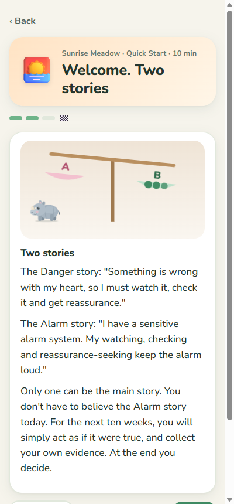
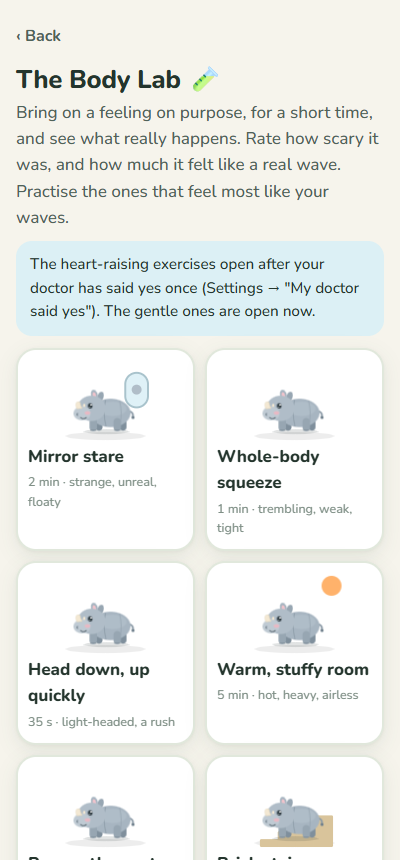
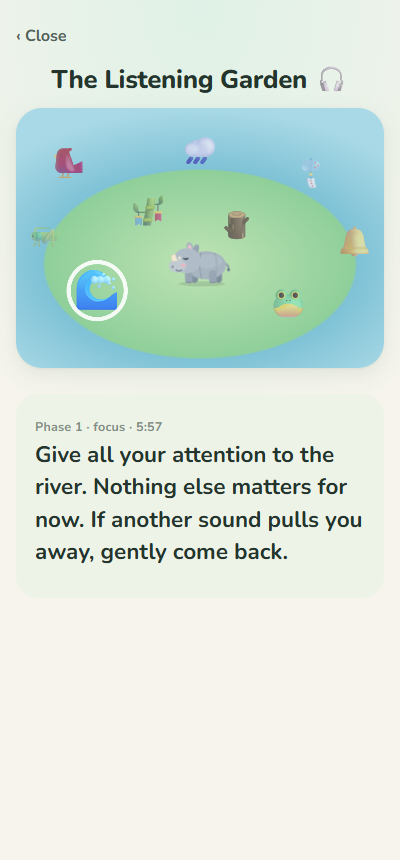
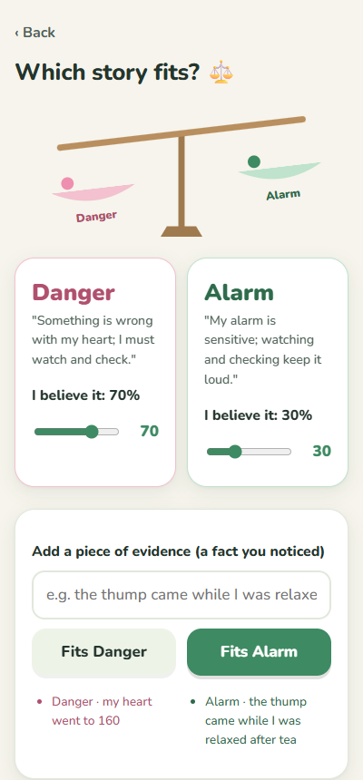

# Calm Path: a playful companion for recovering from health anxiety

**▶ Try it in your browser: https://tarunabhdutta.github.io/calm-path/** · **[Download for Android & Windows](https://github.com/tarunabhdutta/calm-path/releases/latest)** · **[Install guide](INSTALL.md)**

Calm Path helps people whose fear of their own body has taken over: a racing heart, a "thump" in
the chest, the urge to check the pulse, ask "am I OK?" or search symptoms again and again. It turns
a structured, self-guided recovery programme into something that feels like a gentle game, not a
therapy session.

You look after **Tulu**, a baby one-horned rhino from the river islands. Every bit of practice
waters your island and helps it grow.

- **Offline and private.** No account, no sign-up, no ads, no tracking. Your entries stay on your own device.
- **Android app, Windows app, and a web app** that also installs on iPhone and Mac.

| Your island | The journey | SURGE | Calm-time breathing |
|---|---|---|---|
|  |  |  |  |
| **Surf an urge** | **Worry river** | **Treasures** | **Night island** |
|  |  |  |  |
| **Animated lessons** | **Body Lab** | **Listening Garden** | **Two stories** |
|  |  |  |  |

## What's inside
**A 10-week journey (35 short sessions)** across ten illustrated lands, with an animated picture on
every lesson card. It covers:
- understanding the body's alarm;
- dropping checking and reassurance-seeking;
- facing feared situations and body sensations;
- unhooking from anxious thoughts;
- sleep, and getting life back;
- a plan to stay well.

**Practice games (each teaches a skill, never a distraction):**
- **Body Lab:** bring on feared sensations on purpose, in short safe rounds. Heart-raising exercises open only after the user records a doctor's OK.
- **Listening Garden:** attention training with live island sounds.
- **Two stories:** the Danger story versus the Alarm story, with your own evidence.
- **The anxiety forecaster:** every practice is an experiment.
- **Fear loop**, **leaves on the river**, **fight switch**, **get curious**, **ladder** (with random draws) and **little-habit builder**.

**Always one tap away:**
- **SURGE**, for a wave of anxiety.
- **Surf an urge**, instead of checking.
- **Calm-time breathing**.
- **Worry river**.
- **Inner weather check-in** with a sleep diary.
- **Wind-down** and **night guide**.
- **Safety card**.
- **For family**, and **Urge to go to hospital?**

**Built to be safe for health anxiety:**
- Rewards are for practice only. A high anxiety score never costs anything.
- Nothing is ever lost: no streaks that break.
- Checking is never rewarded.
- The app never shows a heart-rate number and never says a symptom is "fine".
- Crisis words always open the safety card.

These rules are checked automatically on every build.

## ⚠️ Important
Calm Path is a self-help companion. **It is not a medical device and does not diagnose or treat
anything.** Use it after a doctor has checked your symptoms, and alongside their care.

- **New, different or severe symptoms:** call a doctor or emergency services (India: **108**).
- **Low mood or thoughts of self-harm:** talk to a doctor or a helpline (India: **Tele-MANAS 14416**, free, 24×7).

## Licence
Copyright © 2026 Tarunabh Dutta. **All rights reserved** from v1.4.0 onwards; see [LICENSE](LICENSE).
Third-party components: [THIRD_PARTY_NOTICES.md](THIRD_PARTY_NOTICES.md).
